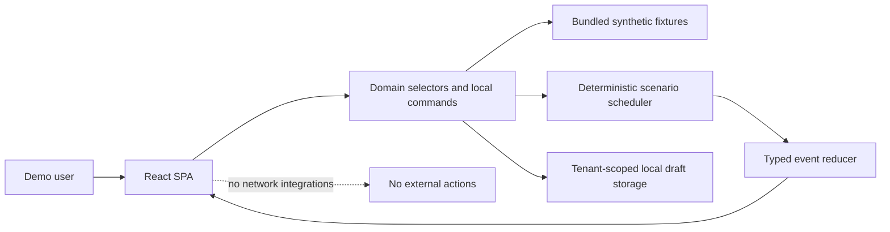
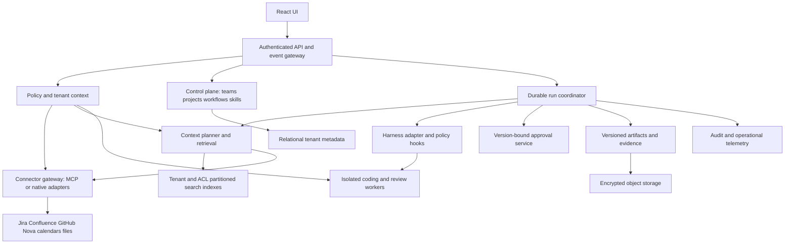
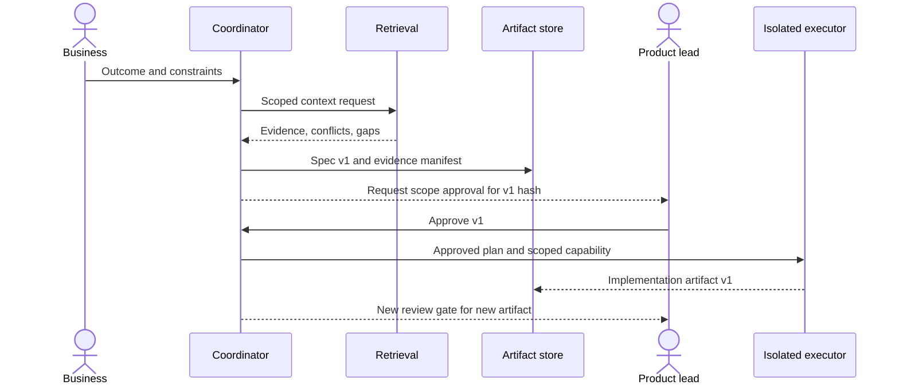

# 02 — Architecture

## Two implementations with a strict boundary

The prototype contains a React SPA, fixture repository, deterministic simulator and local draft store. The future product contains authenticated services, policy enforcement, retrieval, durable orchestration and controlled executors. No backend from the future diagram belongs in prototype implementation.

## Future product topology — design only

## Responsibilities

| Module | Owns | Must not own |
|---|---|---|
| Control plane | Tenant configuration, roles, projects, workflow/skill versions | Connector tokens in browser |
| API/event gateway | Session identity, tenant context, event subscription | Trusting client tenantId as authorization |
| Context planner | Question decomposition, resource selection, evidence ranking | Unbounded “read everything” prompts |
| Retrieval | Keyword + semantic retrieval and relationship traversal | Cross-tenant candidate mixing |
| Connector gateway | Capability discovery, resource ACL mapping, rate limits | Assuming all connectors expose the same tools |
| Run coordinator | Checkpoints, retries, dependencies, approvals | Executing unreviewed client graph code |
| Harness adapter | Approved runner calls, limits, cancellation | Universal compatibility claims |
| Artifact service | Specs, plans, diffs, citations, hashes | Mutating an approved artifact in place |
| Policy service | Effective grants and action checks | Treating model instructions as policy |

Recommended future baseline: relational metadata with tenant-aware row-level policy; object store for snapshots; durable queue/workflow engine; hybrid search with metadata/ACL filters; isolated short-lived workers; central secrets service. Specific vendors and workflow engines are a later ADR, benchmarked against durability, residency and operator skills. A graph database is optional; explicit dependency edges in relational tables are sufficient to start.

## Context pipeline across 133 repositories

1. Inventory connectors, ownership, repository names, domains, CODEOWNERS and declared dependencies.
2. Incrementally ingest authorized tickets, docs and selected code symbols. Store source revision, timestamps, ingestion cursor and ACL snapshot.
3. At request time filter by tenant, project binding, current user grant and resource visibility **before** ranking. Recheck authorization before opening evidence and before action.
4. Search previous decisions/tickets and architecture metadata first; expand only into relevant repositories and dependency neighbors with a context budget.
5. Retrieve targeted files/symbols at pinned revisions. Separate facts, hypotheses, conflicts and missing data. Citation references include line or section locators.
6. Build a context manifest recording selected and excluded sources, revision, scope, freshness and truncation. A no-result query does not establish that a feature does not exist.
7. Produce the normalized artifact and a human-reviewable impact plan. Deeper retrieval is a follow-up, not silent fabrication.

Freshness policy: annotate stale records, invalidate affected indexes on source changes, handle deletion and permission revocation through tombstones and cache invalidation. Never allow a previously cached summary to reveal revoked content. A production design must evaluate summaries as potentially derived sensitive data.

## Tenancy and authorization

Future principal = authenticated subject + server-resolved tenant membership + project grants. Every row, artifact, cache key, index partition, event stream and storage prefix carries tenant identity. Run creation resolves project and resources server-side; workers inherit scoped capability handles, not tenant-wide credentials. Resource identity includes connector instance as well as external ID.

Effective operation = tenant policy ∩ role grant ∩ project binding ∩ connector capability ∩ source ACL ∩ current action gate. Deny overrides allow. An approval does not expand source access. Team admins cannot override tenant-denied resources. Tenant switching clears selection, side panels, timers and cached results. Production tenant isolation requires API and storage tests; the frontend demo cannot prove it.

## Durable execution and approvals

Runs snapshot workflow version, policy version, skill versions, input and source revisions. Checkpoints record outputs, not raw hidden model reasoning. Replay reconstructs visible state; retry creates a new attempt and does not duplicate external side effects. Future writes require idempotency keys and provider reconciliation. Cancellation revokes worker capabilities and records partial effects; it does not claim to undo an already completed external operation. Retry budgets and deadlines are bounded per node and run.

Approval records bind tenant, project, run, artifact ID/version/hash, gate, actor and expiry. Editing scope invalidates downstream approvals. Production deploy requires current CI evidence, allowed environment, independent approver and an explicit release intent. Prototype approvals only change fixture state.

## Threat and failure model

Treat tickets, docs, code comments, skill content and generated UI as untrusted input. Source instructions cannot grant tools or change policy. Future connectors use minimized scopes, validated endpoints, egress controls and centralized secrets; follow the MCP security guidance linked in research. Sandboxed code workers have explicit network/resource budgets. Generated UI can reference only approved catalog components; never evaluate generated JavaScript or raw HTML.

Operational failures: connector rate limits, revoked permissions, source deletions, stale indexes, partial ingestion, schema changes, missing runner capabilities and duplicate events. Each has a visible status, retryability flag, affected resources and a user remedy. A connector outage yields incomplete evidence, not a successful complete analysis.

Observe run/node IDs, duration, usage budgets, retrieval quality, citation coverage, gate outcomes and action receipts. Redact payloads; separate customer audit history from operational logs. Retention, data residency, deletion/export and compliance requirements remain discovery decisions for a real product, not implied guarantees of this design.
