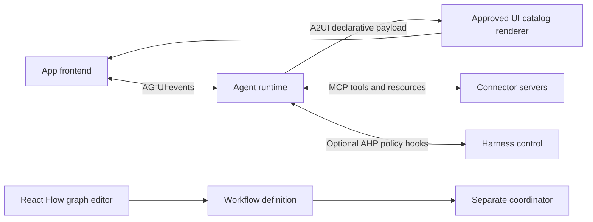

# 03 — Protocol and library decisions

Validated against public primary documentation on 2026-11-02. This is a documentation-level assessment, not a compiled integration compatibility test. Exact dependency resolution belongs to prototype stage 01 and must be recorded in its lockfile. See [source ledger](../research/sources.md).

| Technology | Boundary and finding | Decision |
|---|---|---|
| AHP | Here means A3S-Lab Agent Harness Protocol; repository describes JSON-RPC 2.0, handshake, events and decisions; reports protocol 2.4 / crate 2.4.0 | Experimental optional future policy/harness adapter; local illustrative policy cards only |
| AG-UI | Agent-to-frontend event interaction; lifecycle, text, tool and state events | Use its concepts for fixture playback; do not install a live client in the demo |
| A2UI | Declarative agent-generated UI description using a controlled component catalog | Optional fixture-driven surface preview; no runtime model, HTML evaluation or mandatory SDK |
| MCP | JSON-RPC-based context/tool integration; latest spec URL resolved to 2026-07-28 during research | Future connector boundary, paired with native provider adapters where needed; mock capability registry now |
| React Flow | Node/edge editor using `@xyflow/react`; built-in controls and accessibility support | Actual local canvas, custom nodes and controlled graph state; never a workflow backend |
| React | Official versions page reports 19.3 | React 19 baseline; resolve matching react/react-dom versions during scaffolding |
| Vite | Current guide uses modern build setup; requirements must be checked at install time | SPA with TypeScript; no SSR/server actions needed |
| React Router | Current docs show 8.5.1 and declarative routing | Use declarative route mode; resolve stable compatible release, no server framework needed |
| Tailwind | Official Vite integration uses `@tailwindcss/vite`; docs show v4.3 | Use v4 setup rather than copying v3 directives/config |
| shadcn/ui | Official Vite installation path exists | Own generated UI components in the repository; one consistent primitive family |

## Do not conflate these layers

A2UI payloads can be transported through an interaction channel; that does not make A2UI a transport, AG-UI a UI component library, or MCP an orchestration engine. React Flow edits the definition. A coordinator determines dependency, timeout and execution semantics.

AHP is a project-specific protocol choice, not evidence of universal support across coding products. The acronym is ambiguous outside this kit; if another AHP was intended, replace this ADR after obtaining its authoritative specification. Native runner capabilities must be negotiated or explicitly configured; unsupported capabilities remain disabled. No Cursor/Claude Code/OpenCode adapter compatibility was tested here.

A2UI's official site currently labels v0.9.1 current and v1.0 candidate, with v0.8 legacy and v0.9 stable. Use v0.9.1 as the research baseline, pin any real renderer to its supported schema, and treat candidate changes as an upgrade project. The October 27 official update discusses inference-format improvements; those performance claims are not measured for this platform. The prototype uses an internal approved-surface fixture and explicitly avoids claiming wire conformance.

## ADRs

**ADR-001: local-only SPA.** Chosen for a safe, portable demonstrator with reliable scenarios. Consequence: no real authorization, collaboration or durable execution. Future production requires the services in architecture document 02.

**ADR-002: plain normalized domain store plus React hooks/reducer.** No query cache or state library is required for static fixtures. Derived selectors scope every read by tenant/project. Graph draft and selected node remain separate from domain records. Add a state library only if complexity warrants it; do not add both Redux and Zustand.

**ADR-003: controlled React Flow canvas.** Store nodes/edges and viewport separately from published workflow versions. Use stable node IDs, memoized custom node types and a fixed-height parent. Validation is domain logic, not a side effect of drawing an edge.

**ADR-004: no live agent SDK.** Conceptual protocol compatibility is enough to demonstrate the interaction. Transport clients, API keys and fake endpoints add risk without proving UX. The future adapter contract is protocol-neutral.

**ADR-005: static approved UI catalog.** Demonstrate an evidence card, clarification form, approval card and capacity comparison using typed props. Reject unknown component IDs and oversized payloads with a fallback. Future A2UI integration requires schema validation and renderer-specific verification.

**ADR-006: optional tooling.** React Hook Form + Zod may be selected for nested admin forms after install verification. Lucide may supply consistent icons, and a chart library may be added only for one simple capacity chart. These are recommendations, not verified exact versions. Avoid adding a heavy graph auto-layout dependency; use deterministic seeded positions first.

## Compatibility spike and version policy

Before generating screens: check current runtime requirements, create a Vite React TypeScript project, resolve stable packages, import React Flow and its stylesheet, render one custom node/edge, render a dialog/select/form, navigate one nested route and run a production build. Record actual installed versions, runtime and peer warnings in `IMPLEMENTATION_NOTES.md`; commit the lockfile. Do not invent a package.json containing guessed patch versions. Do not upgrade unrelated dependencies between prompt stages.

The source ledger is a snapshot. Revalidate before starting a later implementation. A documentation claim of support is not a benchmark, security audit, legal license review or confirmation that all listed libraries work together without adjustment.
