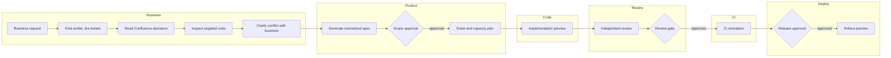
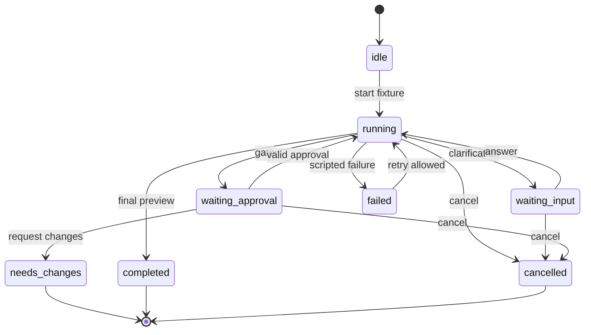

# 06 — Visual workflow and simulation semantics

## Default graph

The default business research sequence is intentionally ordered: similar tickets → Confluence decisions → targeted code → business clarification. Admins can edit that order while maintaining required dependencies.

Change requests create a revised artifact/run attempt; do not add backward graph cycles to model revision. The default workflow is a DAG. Code and review worker identities differ. Notification nodes are draft previews only.

## Node catalog

| Type | Required config | Inputs | Output |
|---|---|---|---|
| trigger | intake template | Business request | request |
| retrieve_tickets | Jira binding, query fields, limit | request | ticketEvidence |
| retrieve_docs | Confluence/file binding, freshness | request, ticketEvidence | docEvidence |
| inspect_code | repo/path allowlist, revision fixture | evidence, request | codeImpact |
| clarify | question template, required flag | conflict list | answers |
| compose_spec | spec template, skill version | evidence, answers, codeImpact | specDraft |
| approval | role, independent flag, artifact key, expiry | versioned artifact | gateDecision |
| plan_capacity | members, leave/calendar bindings, assumptions | ticketDrafts | capacityProposal |
| implement_preview | runner preset, branch label | approvedSpec | fakeDiff |
| review_preview | reviewer preset, checklist version | fakeDiff | reviewFindings |
| ci_preview | suite fixture, blocking suites | reviewedDiff | ciReport |
| deploy_preview | environment, release policy | ciReport, release approval | releasePreview |
| notification_preview | destination fixture, message template | selected artifact | notificationDraft |
| condition | allowlisted field/operator/value | typed upstream output | branch decision |

Node metadata: id, name, type, stage, position, config, bindings, inputMappings, outputSchemaVersion, timeoutSeconds, maxRetries, requiredCapabilities. Config references stable IDs, not display names. Conditions allow equals/in/not-empty and numeric comparison; never evaluate JavaScript expressions.

## Designer interactions

Palette supports drag to canvas and “Add node” keyboard/button alternative. Selecting a node opens its inspector and highlights inbound/outbound edges. Edges have named handles and output mappings. Add/connect/delete/duplicate/move are local edits; duplicate generates a new ID. Deleting a node warns about dependent mappings. Undo/redo stores bounded graph command history. Duplicate/paste remaps internal IDs and rejects cross-project resource bindings.

Node cards show type icon, stage, configured source, output key and status. Validation badges use icon and text. Unconfigured nodes show “Needs setup”; denying a connector displays “Source access missing.” Minimap, fit view and zoom controls remain visible. List view exposes the same node configuration, ordering and errors for keyboard/small-screen use.

## Graph validation

On validate/publish/simulate, check all of the following:

1. Exactly one enabled trigger; at least one terminal node; every enabled node reachable from trigger and able to reach a terminal.
2. No self-loop, duplicate edge, cycle, dangling node or unconnected required input.
3. Output key uniqueness and compatible mapping types. No use of output from an unreachable or downstream node.
4. Bound connector/resource belongs to project tenant and is permitted for node stage and capability.
5. Required config exists; timeout 1–600 seconds; retry budget 0–3. These are demo policy defaults.
6. Spec before implementation, independent review before CI completion gate, CI success and explicit approval before production deploy.
7. Approver roles exist; author cannot satisfy their own independent gate. Tenant policy cannot be weakened by a workflow edit.
8. Branch conditions have a default path. Disabled nodes cannot supply required outputs. A connected path may not bypass required production gates.

Errors include code, node/edge ID, message and suggested fix; selecting one focuses its target. Publish is disabled while blocking errors exist. Warnings do not disappear when the panel closes.

## Version model

Editing creates a mutable draft. “Publish demo version” creates immutable vN and a timestamped local audit record. Simulation snapshots that version, fixture revision and skill versions. Editing the draft cannot change an in-progress run. Compare v1/v2 shows added/removed/config-changed nodes and edges. Restoring v1 creates a new draft, not mutation of v1. Saving an invalid draft is allowed with status; publishing is not.

## Local simulation state machine

Per-node states: queued, running, waiting_input, waiting_approval, succeeded, failed, blocked, skipped, cancelled. Running state is never inferred from an animated edge alone. Each timeline row has timestamp, attempt, safe summary and fixture artifact link. Display activity summaries rather than hidden chain-of-thought.

Scheduler uses scripted relative offsets and a scenario run token. Pause at user-input and approval events. Resume only after permitted local action. Acknowledging a failed test does not turn it green; choose the scenario's remediation/retry step. Retries increment attempt and consume budget. Replay starts a clean run snapshot. Cancel/reset/unmount/tenant switch dispose timers; late events with an old run token are ignored. Event sequence numbers allow duplicate suppression and out-of-order buffering or explicit rejection. All timestamps derive from a fixed clock, not random generation.

Display the event inspector as “AG-UI-inspired fixture playback.” Internal events include domain-specific gates and are not certified AG-UI messages. Future protocol adapters must validate actual wire schemas and translate to these internal domain events.
